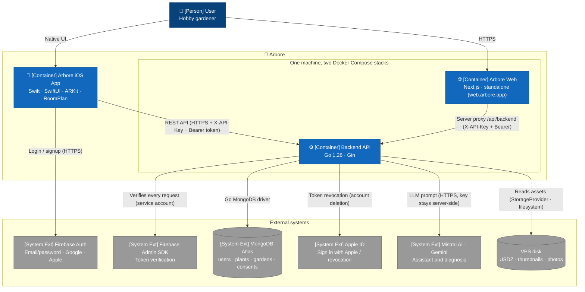

# C4 — Level 2: Containers

This view opens up the "Arbore" box and represents the **deployable applications and services**. A container corresponds to an independently deployable runtime unit: an iOS process, a Docker container, or a managed Apple/cloud service.

For the higher level (actors and external systems), see [`01-context.md`](01-context.md).

## Diagram

> **Rendering note**: the C4 semantics (Person, Container, System Ext) are preserved in the labels. The syntax used is `flowchart` rather than the native `C4Container`, because the C4 Mermaid layout is still experimental and produces edge overlaps on dense graphs.

## Key points

- **Three Arbore containers are in production**: the iOS application, the Next.js web frontend and the Go backend. The Python AI Generator was **dropped on 2026-09-20** (#558), for lack of traffic and with a stale output schema — this page still listed it as live until 2026-11-02. The two server containers are orchestrated by `docker-compose.yml`.
- **A single machine carries both stacks** since the 2026-11-04 cutover (#652): one Debian 12 VPS, two git checkouts, two compose projects (`arbore-prod` and `arbore-dev`). This page claimed two separate machines — the 2026-11-02 state, mid-migration — until 2026-11-13. The old Fedora machine is still powered on as a fallback, with no traffic. See [`../operations/environments.md`](../operations/environments.md) for the exact split.
- **The web frontend is deployed** at `web.arbore.app` (Cloudflare → nginx → `arbore-web` container on port 3000). It serves as a companion to the iOS app: browsing the catalog, the gardens, the watering calendar, and account management (GDPR export/deletion). Gardens are **created on iOS** (AR placement).
- **The web never exposes the API key or the backend URL to the browser**: all calls go through a **same-origin server proxy** (`/api/backend`) that injects `X-API-Key` on the server side and relays the user's Firebase token. As a result: no CORS on the browser side, and the API key is never exposed.
- **Two security barriers protect data access**:
  1. **X-API-Key** validated by a dedicated backend middleware (constant-time comparison) — limits exposure to unauthorized automated requests coming from outside.
  2. **Bearer Firebase token** validated by the Firebase Admin SDK on the backend side — guarantees that the request comes from an authenticated, verified, and non-banned user, and provides their `uid`.
- **MongoDB Atlas is external to the Arbore system** but driven exclusively by the backend. Clients (iOS, web) **never** open a direct MongoDB connection.
- **Backend and Web share the same VPS** and communicate over the internal Docker network (`http://backend:8080`) rather than via the public IP.
- **3D assets are served from disk, not from object storage.** `STORAGE_PROVIDER=filesystem` on both stacks since 2026-10-21: the backend reads the USDZ files and thumbnails from the VPS disk and relays them itself. The R2 bucket still exists and its credentials are kept, but nothing reads it — it is a dormant fallback. This page described a direct 15-minute presigned download until 2026-11-13; it no longer happens. The full reasoning is in [`../operations/asset-storage.md`](../operations/asset-storage.md).
- **HTTPS at the edge**: public access is over HTTPS via Cloudflare (Full strict), with nginx restricted to Cloudflare IPs; the Cloudflare → origin TLS hardening is tracked on the operations side (see [`../operations/vps-bootstrap.md`](../operations/vps-bootstrap.md)).

### The profiled containers

Four `docker-compose.yml` services **never** start with a plain
`docker compose up -d`: they sit behind a profile that has to be named. That is
deliberate — they are tools, not services.

| service | profile | role |
|---|---|---|
| `vignettes` | `outils` | thumbnail rendering job, invoked on demand |
| `vignettes-ouvrier` | `vignettes` | the same binary idling, consuming the `dev` queue |
| `vignettes-ouvrier-prod` | `vignettes-prod` | the same binary, on the `prod` queue |
| `minio` | `dev` | local object storage, **never started** to date |

A worker serves **one** queue only, the one named by its `ARBORE_ENV_NOM` —
hence a second container rather than a second workshop. Both live on the stack
that carries the workshop, declared by
`ARBORE_PROFILS=vignettes,vignettes-prod`.

`minio` exists to exercise the S3 provider without touching R2. Verified on
2026-11-02: no minio container has ever run on the dev machine.

The thumbnail worker is CPU-capped — a Blender render takes everything it is
given, and a catalogue pass runs for hours. See
[`../operations/thumbnail-rendering.md`](../operations/thumbnail-rendering.md).

### The workshop is not a container

`generator.arbore.app` is served by the **same** Next.js container as
`web.arbore.app`, on the same port 3000; nginx tells them apart by
`server_name`, and the Next middleware requires a key session for anything
arriving from that host.

No second service, by design: the origin firewall only opens 80 and 443 to
Cloudflare ranges, and those ports are already covered. One more container
would be one more surface, one more certificate, and one more thing to forget
on hardening day.

A consequence worth knowing: the workshop exists on **every** stack that runs
the web. It disables itself wherever `GENERATOR_KEY_HASH` is unset — "a
workshop without a key would be a workshop without a door".

## Infrastructure choices

- **One VPS per environment**, since the migration under way (#652). Each machine hosts its backend, its web and the storage of plant models and thumbnails. This simple topology fits the current scale (student beta).
  > ⚠️ On the new machine the two stacks share a **single git checkout**, where the old one had two. The compose defaults being relative to the compose file, they converge — which made both backends share their thumbnail directory writable. Tracked in #434.
- **Docker Compose** orchestrates the three server containers via `docker-compose.yml` at the repository root. Kubernetes is deliberately ruled out at this stage to limit operational complexity.
- **Firebase is a managed service**: the project consumes authentication without taking on its operation. The vendor lock-in / delivery-speed trade-off is recorded in [ADR 0004](../decisions/0004-firebase-auth.md).

## Out of scope for this view

- The detail of the **modules inside** a container belongs to level 3 (Component), covered in [`03-components-ios.md`](03-components-ios.md), [`03-components-backend.md`](03-components-backend.md), and [`03-components-web.md`](03-components-web.md).
- The **MongoDB data schema** is documented in [`04-data-model.md`](04-data-model.md).
- The **user journeys** (signup, AR placement, garden saving) are described in [`../flows/`](../flows/).
- **Deployment** (VPS, Docker, TestFlight) is documented in [`../operations/`](../operations/).
