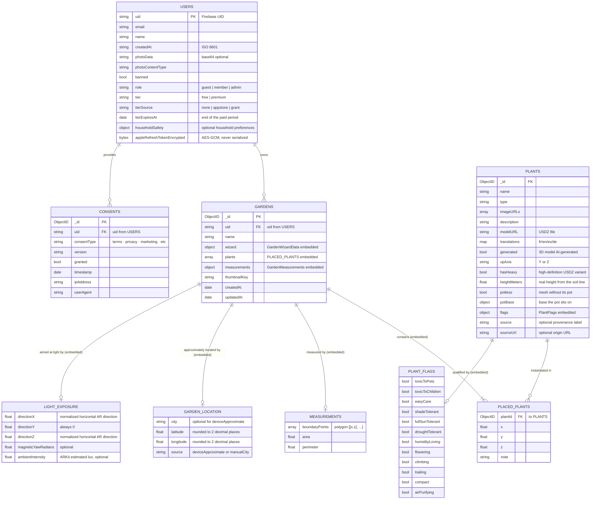

# Data Model — MongoDB

This view describes the schema of the MongoDB collections used by Arbore. The Go backend is the **only** direct consumer of this database; the iOS app and the web front necessarily go through the REST API.

The schema is deliberately **denormalized** in certain respects (embedded plant translations, placed plants embedded in the garden) in order to reduce the number of Mongo round-trips during API calls. No referential integrity constraint is enforced by Mongo: consistency is ensured at the application level by the backend.

There are **four collections**: `users`, `plants`, `gardens`, `consents`. Two physical databases are selected per request (`arbore` in prod, `arbore_test` in test) according to the selector set by the API key.

## ER Diagram



## Collections

### `users`

Document representing an authenticated user. The functional key is `uid` (Firebase UID), not the Mongo `_id`.

| Field | Type | Notes |
|---|---|---|
| `uid` | string | Firebase UID. Functional key for all `bson.M{"uid": ...}` filters. |
| `email` | string | Email provided by Firebase Auth. |
| `name` | string | Display name. Editable via `PATCH /users/me` (#138). |
| `createdAt` | string | Signup date in ISO 8601 format (stored as a **string**, not a BSON date). |
| `photoData` | string (optional) | Profile photo as base64. Source of truth. |
| `photoContentType` | string (optional) | Associated MIME type. |
| `banned` | bool | Moderation flag checked by the Firebase middleware on every request. |
| `role` | string (optional) | `guest` \| `member` \| `admin` (`owner` and `support` reserved, not implemented). **Defaults to `member`**: a missing field — every document predating #377 — normalizes at read time, so no backfill is needed. It is **never** populated from a client binding (#377). |
| `tier` | string (optional) | `free` \| `premium`. Defaults to `free`. A **separate** axis from the role: merging them would produce a cartesian product as soon as an administrator is also a subscriber. |
| `tierSource` | string (optional) | `none` \| `appstore` \| `grant` — where the subscription came from, kept for audit: a `premium` must always be explainable. |
| `tierExpiresAt` | date (optional) | End of the paid period. Checked **at read time** (`NormalizeTier`): otherwise an expired subscription would stay `premium` until an external job ran. |
| `householdSafety` | object (optional) | Persistent `avoidPetToxicity` and `avoidChildToxicity` preferences, editable with the name through `PATCH /users/me`. They are automatically applied to new gardens. |
| `appleRefreshTokenEncrypted` | bytes (optional) | Apple refresh token encrypted with **AES-256-GCM**. `json:"-"` — **never** serialized to clients; `nil` if the user has never used Sign in with Apple. Written by `linkAppleAccount`, read by `deleteUser` for revocation (#210). |

### `plants`

Plant catalog document. Each plant embeds its multilingual translations so that a single `findOne` retrieves all the information.

| Field | Type | Notes |
|---|---|---|
| `_id` | ObjectID | Primary key. Referenced by `PlacedPlant.plantId`. |
| `name` | string | Canonical name. |
| `type` | string | Plant family / type. |
| `imageURLs` | array<string> | Since #527, **our own studio renders**: `https://api.arbore.app/models/thumbnails/<id>.png?v=<version>`. One entry per record. |
| `description` | string | Description in French (served by default). |
| `modelURL` | string | USDZ file name served by `GET /models/:filename`. |
| `translations` | map<lang, LanguageData> | Sub-document per language (`fr`, `en`, `es`, `de`). |
| `generated` | bool (optional) | `true` if the 3D model is AI-generated (BETA badge, #84). |
| `upAxis` | string (optional) | `"Y"` or `"Z"` — rotation applied at load time (#89). |
| `hasHeavy` | bool (optional) | `true` if a **high-definition** USDZ variant exists (served via `?lod=heavy`). Drives the LOD swap in AR — see [`../3d-lod-architecture.md`](../3d-lod-architecture.md). |
| `heightMeters` | float (optional) | Real height of the specimen, **measured from the soil line**, not from the bottom of the pot: the pot changes, the plant does not. When absent, the client falls back on its 0.5 m constant (`autoScaleTargetHeightMeters`), which gives every plant the same size. |
| `versions` | `AssetVersions` (optional) | Content fingerprints of the files served. They drive device cache invalidation; their absence leaves the client on its current behaviour. |
| `potless` | bool (optional) | `true` if the mesh **does not contain its pot** (re-cut output of the 3D workshop). Absent or `false` means the pot is part of the mesh, the historical behaviour. |
| `potBase` | `PotBase` (optional) | Base measured by the workshop: centre, radius, rim height, in model units. Without it, no pot is served. |
| `flags` | `PlantFlags` (optional) | Legacy flags still used by visual filters and as weak evidence. They can no longer certify suitability on their own. |
| `botanicalProfile` | `PlantBotanicalProfile` (optional) | Canonical horticultural constraints, structured and sourced per field. When absent, the verdict can only be “Probably compatible” or “Not suitable,” never “Suitable.” |
| `source` | string (optional) | Optional provenance label (curated catalog vs legacy/beta entries). |
| `sourceUrl` | string (optional) | Optional origin URL, kept for later updates. |

##### Why the photos are ours

The 123 records used to carry direct links to the botanic (97) and Unsplash (25)
CDNs. The app copied nothing: every device fetched them itself, and those third
parties saw the user's IP address, the time, and which records were viewed — a
flow the privacy policy did not mention for botanic.

Botanic's terms also explicitly forbid reproduction (articles L.122-4 and
L.335-3 of the French intellectual property code), and some of their visuals come
from stock agencies that license them to botanic, not to us. Hosting a copy was
therefore out.

Our studio renders settle all three points at once: no third-party call, no one
else's rights, and the user sees exactly what they will place in augmented
reality. They are the same files served to the catalogue cards, so one cache
entry per plant.

> ℹ️ **The generation path no longer exists.** `generateAndInsertPlant` and its
> Unsplash enrichment went with the AiGenerator microservice, removed on
> 2026-09-20 (#558). No third-party URL enters the catalogue any more, and #526
> closed itself.

The `translations[lang]` sub-document (type `LanguageData`) groups:

```
LanguageData {
  description, plantType,
  sun: {lightType, durationPerDay, orientation, windowDistance, recommendedRooms, tips},
  water: {frequency, amount, method, humidity, signsLack, signsExcess, recommendedWater},
  soilAndPot: {substrate, drainage, potSize, repotFrequency, repotSigns},
  health: {commonProblems, symptomsAndCauses, pests, treatments, prevention},
  lifeCycle: {growth, flowering, dormancy, fertilizer, pruning},
  care: {difficulty, weekly, monthly, yearly, extraTips}
}
```

All 123 records carry the **four languages** since #513 and #514. Before that,
97 of them had only `fr` and `en`, and a Spanish or German reader saw English
through the `language → en → any` fallback.

##### `care.difficulty` is not prose

This field is read **by keyword**, not displayed as-is: `Plant.careDifficulty(locale:)`
matches it against a fixed list, and the catalogue's difficulty filter depends on
it. The binary shipped to testers carries its own copy of that list, so widening
it in code does not help installations already deployed.

The only recognised labels, to be written exactly:

| level | `fr` | `en` | `es` | `de` |
|---|---|---|---|---|
| easy | Facile | Easy | Fácil | Einfach |
| moderate | Intermédiaire | Moderate | Intermedio | Mittel |
| hard | Exigeant | Hard | Difícil | Anspruchsvoll |

⚠️ "Difficult" and "Demanding" are **not** recognised, hence "Hard" in English.
The writing scripts therefore reimpose these values from English rather than
leaving them to the translator, human or machine (#485, #512).

##### A partial translation makes the plant disappear

`description` and `plantType` are **non-optional** on the app side. Writing a
language without those two fields does not degrade the display: the record
becomes undecodable and the plant vanishes from the catalogue, **in every
language**, including the ones that were fine.

Two protections, at two levels:

- the writing scripts (`scripts/translate-plant-catalog.py`,
  `scripts/apply-translation-memory.py`) check each record for completeness
  before writing, and never overwrite an existing language;
- since #515, `Plant.init(from:)` decodes `translations` **language by
  language**: an unreadable language costs only that language, and the reader
  falls back to `en`.

The model-level guard exists because the scripts' discipline protects nothing the
moment a `$set` is typed by hand in `mongosh`.

#### `PlantBotanicalProfile` sub-document

The environmental engine reads this sub-document first. It includes indoor/outdoor environments, minimum temperature, direct-sun hours, indoor humidity, watering interval, drainage, mature height and width, minimum pot volume and depth, wind/drought/salt tolerance, pet/child toxicity, and a schema version.

Each value is either a `PlantFact<T>` (`value` plus `evidence`) or a `PlantRangeFact` (`minimum`, `maximum`, `unit`, `evidence`). `evidence` stores `sourceName`, `sourceURL`, `reviewedAt`, and `reliability`. To allow a **Suitable** verdict, a value being used must have a source, a review date, and `high` reliability. Missing or insufficiently sourced values remain explicitly unconfirmed.

Critical constraints — indoor/outdoor, hardiness, directly incompatible light, requested toxicity safety, pot volume, and available dimensions — run before aesthetic ranking. A known conflict produces **Not suitable**. With no conflict but an unknown critical value, the strongest possible verdict is **Probably compatible**.

#### Legacy `PlantFlags` sub-document

Twelve historical booleans. They remain useful for search and appearance filters. A `true` toxicity flag may still trigger a precautionary exclusion, but `false` does not prove safety because the old schema conflated “false” and “not researched.”

| Flag | Meaning |
|---|---|
| `toxicToPets` | Toxic to pets. |
| `toxicToChildren` | Toxic to children. |
| `easyCare` | Easy to care for. |
| `shadeTolerant` | Tolerates shade. |
| `fullSunTolerant` | Tolerates full sun. |
| `droughtTolerant` | Tolerates drought. |
| `humidityLoving` | Loves humidity. |
| `flowering` | Flowering plant. |
| `climbing` | Climbing. |
| `trailing` | Trailing. |
| `compact` | Compact size. |
| `airPurifying` | Air-purifying. |

#### `AssetVersions` sub-document

Content fingerprint of each file served for the record: the first eight
hexadecimal characters of its SHA-256. It drives device cache invalidation
(#294).

| Field | Type | Role |
|---|---|---|
| `model` | string (optional) | Light USDZ. |
| `modelHeavy` | string (optional) | Heavy USDZ, served via `?lod=heavy`. |
| `thumbnail` | string (optional) | PNG thumbnail. |

One field per file, because they are distinct files: replacing the light one
must not force a re-download of the heavy one, which is ten times larger. A
missing field means “fingerprint not computed” — the client then falls back on
its previous behaviour and keeps its cache.

##### Why a per-file fingerprint rather than a global counter

The iOS model cache is keyed by **file name**, under `Documents/Models/`, which
an app update does not clear. A file rewritten under the same name therefore
reaches no device that already downloaded it: that is #292, where testers kept
grey models until they reinstalled.

The obvious fix — a version constant in the binary — is already in place for
thumbnails, and #524 measured what it costs. It is **global**: changing it
invalidates the whole catalog for everyone in order to fix a single file, 440 MB
for the light models. And it is **compiled in**: changing it reaches nobody
without a new TestFlight build, so fixing a file server-side stays invisible.

A content fingerprint has neither flaw. It changes when the bytes change, never
otherwise, nobody has to remember to bump it, and it travels with the record the
client already reads.

The conditional GET, the other path in #294, is available server-side at no
cost: `serveStorageObject` ends in `http.ServeContent`, which emits
`Last-Modified` and honours `If-Modified-Since`. But it costs one request per
file per check, where the fingerprint rides along with the catalog.

#### `PotBase` sub-document

The base measured by the 3D workshop, where the pot sits. Every value is in
**plant-model units**, not centimetres: the mesh is not at real-world scale.

| Field | Type | Role |
|---|---|---|
| `x`, `y`, `z` | float | Base centre; `y` is the rim height, where the top of the pot lines up. |
| `radius` | float | Base radius. This is what scales the pot. |
| `groundY` | float (optional) | Soil line, for trailing-foliage anti-clipping (#185). Rarely measured so far. |
| `plantHeight` | float (optional) | Height of the plant alone. |

### `pots`

Pot library, **unrestricted**: any pot goes under any plant. No per-plant
compatibility is recorded, for want of evidence that it is needed (open question
in #623).

| Field | Type | Role |
|---|---|---|
| `_id` | ObjectID | Identifier served as-is to the client. |
| `name` | string | Label. |
| `modelURL` | string | USDZ file name, served by `GET /models/:filename` like plant models. |
| `rimRadius` | float | Rim radius, in **pot**-model units. |
| `height` | float | Pot height. |
| `default` | bool | Pot served when the client asks for none. |
| `version` | string (optional) | Content fingerprint of its USDZ, same rule as `AssetVersions`. |

##### How plant and pot compose, and where the maths happens

A `potless` plant cannot be displayed on its own. `GET /plants/:id` therefore
serves a `pot` field in the same payload — the one `?pot=<id>` asks for, or the
default. A separate call would always be serial behind the plant's, since the
client only learns afterwards that it needs a pot.

The fit itself is **not** served: the pot is scaled by
`potBase.radius / pot.rimRadius`, centred on the base, its rim aligned with
`potBase.y`. The client has both values and does the division.

That split is deliberate. Switching pots never goes back to the server: the base
is a measurement of the plant, independent of any pot, and the library is
fetched once and kept. The picker preview is therefore instant and a garden
reopens offline. Re-serving the whole record — translations, botanical profile,
images — for one division would be waste, and stating the rule on both sides
would let it drift.

The server keeps exactly one computing duty: **refusing** to serve a pot when
the fit is meaningless — missing base, zero radius or zero rim. A visibly bare
plant can be fixed; a pot placed at random reads as an AR bug.

##### Why the re-cut model changes file name

The pot-less model does not replace the old one: it lands beside it, suffixed
`_potless`. The iOS cache is keyed by **file name** and `Documents/Models/`
survives app updates (#294) — rewriting a file under the same name would reach
no device that already downloaded it. And `GardenLocalStore` persists
`modelURLString` in every saved garden: the old file must stay served, or
already-created gardens break.

### `gardens`

Document representing a garden created by a user. Placed plants are **embedded** — reading an entire garden costs only one `findOne`.

| Field | Type | Notes |
|---|---|---|
| `_id` | ObjectID | Primary key. |
| `uid` | string | Owner UID (logical FK to `users.uid`). Set server-side from the token, filtered in all CRUD operations. |
| `name` | string | Display name. |
| `wizard` | `GardenWizardData` | Wizard choices, scan method, optional exposure capture, approximate location, conditional answers, and optional space profile. |
| `plants` | array<`PlacedPlant`> | Placed plants (see below). |
| `measurements` | `GardenMeasurements` (optional) | Geometry of the room/garden traced in AR: `boundaryPoints` (polygon), `area`, `perimeter`. Accepted on creation and on update. |
| `thumbnailKey` | string (optional) | Image key for the garden thumbnail on the home screen. |
| `createdAt`, `updatedAt` | date | Timestamps managed by the backend (`updateGarden` updates `updatedAt`). |

Optional `wizard.location` sub-document (`GardenLocationData`):

| Field | Type | Notes |
|---|---|---|
| `city` | string (optional) | City from approximate reverse geocoding or manual input. |
| `latitude`, `longitude` | float (optional) | Device coordinates rounded to two decimal places on iOS before transmission; absent for manual input. |
| `source` | string | `deviceApproximate` or `manualCity`. |

The model deliberately has no exact-address field. The backend only persists the already-minimized DTO sent by the client.

`state.location` is reset whenever a new garden starts. After the scan, the app performs a new one-shot measurement or asks for a new city; it never copies the location of another garden.

Optional `wizard.lightExposure` sub-document (`GardenLightExposureData`), collected only for a room, balcony, or terrace:

| Field | Type | Notes |
|---|---|---|
| `directionX`, `directionY`, `directionZ` | float | Direction aimed at by the camera in the scan's AR frame, projected and normalized horizontally (`directionY = 0`). |
| `magneticYawRadians` | float (optional) | Yaw relative to magnetic north when Core Motion provides that reference frame. |
| `ambientIntensity` | float (optional) | Instantaneous ambient-light estimate supplied by `ARLightEstimate`, in lux. |

The AR direction and magnetic yaw connect the measured geometry to a real-world orientation. The light value is a point-in-time signal, not a lasting sunlight measurement.

Optional `wizard.conditionalAnswers` sub-document (`GardenConditionalAnswersData`), declared after location:

| Field | Values | Context |
|---|---|---|
| `plantingMode` | `inGround`, `containers`, `both` | Garden. |
| `drainage` | `fast`, `normal`, `slow` | Garden, water behaviour after heavy rain. |
| `windExposure` | `sheltered`, `sometimesWindy`, `veryExposed` | Balcony or terrace. |
| `maximumContainerSize` | `small`, `medium`, `large` | Balcony or terrace: up to 10 L, up to 30 L, or 30 L and above. |
| `wateringCapacity` | `low`, `regular`, `frequent` | Garden, balcony, or terrace. |
| `directSunDuration` | `none`, `oneToThreeHours`, `fourToSixHours`, `moreThanSixHours` | Room; replaces any inference from a single lux reading. |
| `indoorHumidity` | `dry`, `normal`, `humid` | Room. |
| `nearbyHeat` | `none`, `radiator`, `underfloorHeating`, `airConditioning`, `heatingAndAirConditioning` | Room. |

`containerProject` remains decodable only for legacy gardens. Safety is still readable from `wizard.safety`, but it is no longer asked for every garden: persistent `users.householdSafety` preferences are loaded when the wizard starts and copied into the new garden snapshot so toxicity exclusions can run. A skipped question or “I don't know” is never encoded.

Optional `wizard.siteProfile` sub-document (`GardenSiteProfileData`), edited from the 2D plan:

| Field | Type | Notes |
|---|---|---|
| `orientation` | `GardenOrientationData` (optional) | 0–360° direction, with 0° = north. |
| `sunlight` | `GardenSunlightData` (optional) | `minimumHours` / `maximumHours` range. |
| `wind` | `GardenWindData` (optional) | `sheltered`, `light`, `moderate`, or `strong`. |
| `availableHeight` | `GardenAvailableHeightData` (optional) | Height in metres, declared until it can be measured. |
| `climate` | `GardenClimateData` (optional) | Historical min/max temperatures, frost risk, altitude, and coastal exposure, with provenance. Filled automatically by `POST /climate/profile` after location when a city or approximate position is available. |
| `plantingZones` | array<`GardenPlantingZoneData`> | Named and excludable X/Y/Z polygons in the outline's coordinate frame. |

Every value has `metadata` with a `source` (`measured`, `inferred`, `declared`, `regionalEstimate`), `confidence` (`high`, `medium`, `low`), and optional `sourceReference` and `observedAt`. Fields remain absent until real data is available; the interface does not fabricate replacement values. Backend climate enrichment can use Météo-France Données Publiques when a server key is configured; otherwise it returns a lower-confidence Arbore regional estimate.

`PlacedPlant` sub-document:

| Field | Type | Notes |
|---|---|---|
| `plantId` | ObjectID | FK to `plants._id`. |
| `x`, `y`, `z` | float | 3D position **in the garden's coordinate frame** (not the ARKit world frame, local-only iOS). |
| `note` | string (optional) | Free-form note. |

⚠️ **Current limitation**: the 3D position persisted server-side includes neither rotation nor scale. The real 4×4 transforms live only in the local `scene_{id}.json` on the iOS side (#114).

### `consents` — GDPR

Append-only audit trail. An entry is created on every action (accept/decline), never modified.

| Field | Type | Notes |
|---|---|---|
| `_id` | ObjectID | Primary key. |
| `uid` | string | User UID (logical FK to `users.uid`). |
| `consentType` | string | `"terms"`, `"privacy"`, `"marketing"`, etc. (#67). |
| `version` | string | Version of the consent document presented. |
| `granted` | bool | `true` if accepted, `false` if declined/withdrawn. |
| `timestamp` | date | Auto-set to `time.Now()` if absent. |
| `ipAddress` | string | **Always cleared** by `recordConsent`: the IP is not needed to prove consent and would add personal data to the database. The field remains in the schema for historical documents. |
| `userAgent` | string | Auto-set to the User-Agent if absent. |

## Indexes

Declared in `indexes.go` (`requiredIndexes`) and created at startup by `ensureIndexesAtStartup()`, on the production database **and** on `arbore_test`. The operation is idempotent, and a failure is logged without blocking startup (without indexes the API still works, only slower).

| Collection | Index | Used for |
|---|---|---|
| `users` | `{uid: 1}` **unique** | Access profile read on **every authenticated request** (`loadAccessProfileFromDB`: ban status, role and subscription tier in a single query) + profile reads/writes, and the **structural guarantee of account uniqueness** |
| `gardens` | `{uid: 1, updatedAt: -1}` | `listGardens` (filter `uid` + sort `updatedAt`); also acts as a prefix for queries on `uid` alone |
| `consents` | `{uid: 1, timestamp: -1}` | `getUserConsents` / `getLatestUserConsents` (filter `uid` + sort `timestamp`) |

Before these indexes, the only indexed collection was indexed on `_id`: every authenticated request triggered a **full collection scan** of `users` (audit #338, finding 7).

> ✅ **`users.uid` is unique.** Two complementary protections, and both are needed: `createUser` as an **upsert** avoids creating duplicates, but only the **unique index** makes duplication impossible — including for a script, a manual write, or a future code path that forgets the rule (audit #338, finding 1).
>
> **History.** `createUser` performed an unconditional `InsertOne` and `deleteUser` a `DeleteOne`: production held 30 documents for 7 uids, and deleting an account left personal data behind while the Firebase identity was removed. Migration applied on 2026-07-26 via `ArboreBackend/scripts/dedupe-users.js`: **48 → 25 documents, 0 duplicates, no user lost**.
>
> **Merge rule**: field missing/empty → the non-empty value wins; two differing non-empty values → the most recent wins; `createdAt` → the oldest; `banned` → `true` if any copy is. The survivor is the document with the oldest `_id`.
>
> This rule is deliberately not "keep the most recent copy", and that is not a detail: measured in production, **2 of the 7 duplicated accounts carried their `appleRefreshTokenEncrypted` only on their oldest copy**. Losing it would have made Apple account revocation impossible on deletion (Guideline 5.1.1(v), see #210).
>
> ⚠️ **Changing the characteristics of an existing index is not possible in place.** MongoDB returns either `IndexOptionsConflict` (**85**, options differ) or `IndexKeySpecsConflict` (**86**, key specs differ). Adding `unique: true` to an existing index returns **86** — verified in production. `ensureIndexes` therefore does **not** attempt to replace the index automatically: a `drop` followed by a failing `create` would leave the collection with no index at all, hence a full scan on every authenticated request. The log prints the `dropIndex`/`createIndex` command to run instead, once duplicates are gone.

`plants` is not indexed. Since the generator was removed (#558), no lookup by name reaches Mongo at all: the catalogue grounding of #554 loads the 123 names **once every fifteen minutes** and matches them in memory, which makes an index moot. Should a name lookup return on the database side, the right answer would still be an indexed `nameNormalized` field — a case-insensitive regex cannot use an index on `name`.

## Relations between collections

All relations are **logical** (by `uid` or `ObjectID`), none is enforced by Mongo. Consistency relies on:

- `deleteUser`, which deletes **in cascade**: gardens → consents → (best-effort Apple revocation if `appleRefreshTokenEncrypted` present) → user.
- The `bson.M{"_id": id, "uid": uid}` filters, which guarantee ownership on garden update/delete.
- The `uid` always injected from the token, never accepted from the body.
- `exportUserData` (GDPR art. 20), which aggregates user + gardens + consents, but **excludes** `appleRefreshTokenEncrypted`.

## Note — documents in test mode

Insertions through the **test** database selector are tagged by `maybeLabelTestDoc` with two out-of-schema fields: `_test: true` and `_createdAtUTC`. These fields **never** appear in production documents and are not part of any Go struct; they enable safe cleanup of the test database.

## Out of scope for this view

- Grounding AI answers on this collection (`catalog_context.go`) belongs to [`03-components-backend.md`](03-components-backend.md).
- The local iOS files (`scene_{id}.json`, `worldmap_{id}.arworldmap`) are client-specific and do not appear in Mongo — see [`03-components-ios.md`](03-components-ios.md).
- The signup and garden save sequences are documented in [`../flows/`](../flows/).
