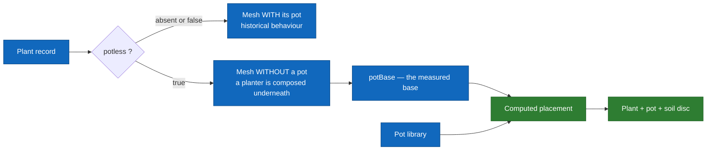

# Pots and planters

Since the 3D workshop started producing **cut** plants — a mesh without its
original pot — a plant can no longer be displayed on its own: it needs a
planter, and the scale of that planter depends on the plant.

This page says who decides what. It exists because the rule lives in three
places — the Go backend, the iOS app, the workshop — and a rule written three
times drifts unless someone says which one is authoritative.

For how the meshes are made, see [`../operations/3d-workshop.md`](../operations/3d-workshop.md).
For the record's fields, [`04-data-model.md`](04-data-model.md).

## Two states, one field



`sansPot(p)` is `p.Potless != nil && *p.Potless`: **without the field, nothing
changes**. Historical plants render exactly as before.

## The base, and why it is not in centimetres

`potBase` (`PotBase` in `ArboreBackend/pots.go`) is measured by the workshop
**in the plant model's own units**, not in centimetres: a generated mesh is not
at real-world scale.

| field | what it carries |
|---|---|
| `x`, `y`, `z` | centre of the base — `y` is the **rim height**, where the top of the pot aligns |
| `radius` | radius of the base |
| `groundY` | soil line (#185) |
| `plantHeight` | height of the plant alone |

The **real** size is a different field, `heightMeters`, measured separately on
`/generator/tailles` — from the soil, not from the bottom of the pot. Without
it the client falls back on `autoScaleTargetHeightMeters = 0.5 m`, which makes
every plant the same size. The two are not interchangeable: one places the
**pot**, the other places the **plant**.

## Who serves what

| | route | what it returns |
|---|---|---|
| the library | `GET /pots` | the pots alone, with no placement |
| one record | `GET /plants/:id` | the plant **plus its resolved pot**, in the same payload |
| one record, another pot | `GET /plants/:id?pot=<id>` | the same, with the requested pot |
| the catalogue | `GET /plants` | every `potless` plant with its default pot |

**The default pot travels with the plant, and that is a choice.** A second call
would always be serialised behind the first — the client only learns afterwards
whether the plant needs a pot — and the plant would render bare for the
round-trip. The JSON stays flat: `plantResponse` embeds `Plant` and adds an
optional `pot`, so a client ignoring the field sees no change.

**Changing pots, on the other hand, does not go back to the server.** The base
belongs to the plant, the library is loaded once and kept, and the placement is
a single division. The picker is therefore instant, and a garden reopens
offline.

> A requested pot that no longer exists **does not raise an error**:
> `choisirPot` falls back to the default. The user's choice is persisted in
> their scene; an error here would empty an already-saved garden.

## The placement rule

```
scale  = base.radius / pot.rimRadius
centre = (base.x, base.y, base.z)
```

The pot is scaled, centred on the base, **its rim aligned with `base.y`**.
That is all — `PlantPotComposer.placement`, in
`ArboreUi/ArboreUi/Models/PlantPot.swift`, and `poserPot` on the Go side.

### The soil disc

The workshop only keeps the plant's soil out to **75 %** of the radius, while
the pot is placed at 100 % of `base.radius`. Without a disc at the bottom, a
ring of bare wall stays visible all around.

Four constants size it, and they describe **this pot**, not a general rule:

| constant | value | what it measures |
|---|---|---|
| `partOuverture` | `0.9445` | share of the rim taken by the **opening** — `rimRadius` is the outer radius, and the wall forms two shells (0.0589 and 0.0554 measured) |
| `retraitTerre` | `0.06` | setback of the soil face below the rim, as a share of height |
| `margeDisque` | `0.985` | margin against z-fighting with the wall |
| `epaisseurDisque` | `0.02` | thickness, as a share of height |

> **These four values exist twice**, in `pots.go` and in `PlantPot.swift`. The
> duplication is deliberate — the server composes for the catalogue, the app
> recomposes in AR after a pot change — and **a test pins them by name on both
> sides**: changing one side only fails CI instead of drifting silently.
>
> The day the library holds a second pot, these stop being constants and become
> measurements to carry on its record.

The disc is computed from the pot's dimensions **after scaling**, as the engine
reads them off the loaded mesh, not from the record's fields: in AR the client
only has a `PersistedPot`, which carries the placement but neither `rimRadius`
nor `height`. Without usable dimensions, no disc — a bare ring beats a disc in
the wrong place.

## What is saved, and where

The chosen pot lives in the **local scene**, `scene_{id}.json`, under
`PersistedPot` (`ArboreUi/ArboreUi/Views/GardenLocalStore.swift`): identifier,
model URL, scale, offset, and the content fingerprint so the cache follows a
replaced pot. The placement is stored **already resolved**, just as the plant
stores its own transform.

> ⚠️ **The Mongo `gardens` document carries no pot at all.** `PlacedPlant` only
> has `plantId` and a position. A garden saved **before** 1.0.2 therefore
> reopens without its pots: the data was never written, and nothing can
> reconstruct it. Gardens created since keep them.

## What does not exist, and why

- **No pot ↔ plant compatibility.** The library is free: any pot goes under any
  plant. Nothing today justifies per-plant constraints — open question in #623.
- **No pot is served without a `potBase`.** A cut plant whose base has not been
  measured gets nothing, by design: placing a pot at a guessed scale would be
  worse than placing none.

## See also

- [`../operations/3d-workshop.md`](../operations/3d-workshop.md) — the cut, the base measurement, the sizes page
- [`../operations/chaine-plante.md`](../operations/chaine-plante.md) — the end-to-end chain
- [`04-data-model.md`](04-data-model.md) — `potless`, `potBase`, `versions`
- [`03-components-backend.md`](03-components-backend.md) — the routes and their guards
