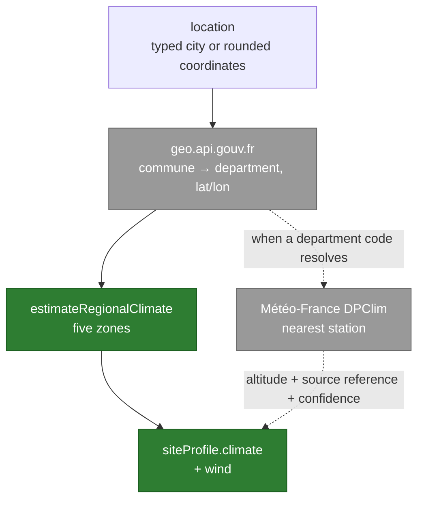

# The climate profile and the site record

After the scan, the user gives an approximate location or a city name. The
backend derives a **site profile** from it — historical temperatures, frost
risk, wind, coastal exposure, altitude — which then feeds the catalogue
ranking.

This page says what that profile really contains, and above all **what it does
not measure**. It exists because the route was mentioned in passing by four
documents without any of them describing its content.

Code: `ArboreBackend/climate.go`. User flow:
[`../flows/garden-creation.md`](../flows/garden-creation.md).

## The route

`POST /climate/profile`, in the **protected** group (API key + Firebase token).
Body: a `location`. Response: a `siteProfile` and an `attribution`.

Without a usable location the route answers **422** and the journey continues
without climate: the catalogue engine then keeps its missing data as "to be
confirmed" rather than guessing.

## Five zones, and a default

`estimateRegionalClimate` sorts the commune into one of five zones, through
name and coordinate heuristics:

| zone | frost | wind | confidence |
|---|---|---|---|
| `mediterranean` | `occasional` | `moderate` | `medium` |
| `mountain` | `severe` | `moderate` | `medium` |
| `oceanic` | `occasional` | depends on the coast | `medium` |
| `continental` | `regular` | `light` | `medium` |
| `temperate` *(default)* | `regular` | `light` | **`low`** |

Evaluation order matters: mediterranean, mountain, oceanic, continental, then
the temperate fallback. A commune triggering no heuristic therefore gets an
explicitly low-confidence profile, and says so.

## What Météo-France brings — and what it does not

When a department code resolves, the backend queries the **DPClim** API of
Météo-France Données Publiques for the **nearest station**.

> ⚠️ **The temperatures remain those of the regional estimate.** The station
> provides no reading: it contributes its **altitude**, changes the source
> reference shown, and lifts confidence from `low` to `medium`. The
> `metadata.source` field is `regionalEstimate` in every case, station found or
> not.
>
> This is not a hidden flaw: it is what the field declares. But the attribution
> displayed — "Source: Météo-France Données Publiques" — can suggest a
> measurement, when it names the station used to situate the place.

The call is bounded at **3.5 seconds** (`climateRequestTimeout`). A failure, a
timeout or a missing station fails nothing: the regional profile goes out as
is, with its original confidence.

## What the profile carries

| field | content |
|---|---|
| `climate.historicalMinimumTemperature` · `...Maximum` | the zone's bounds, in °C |
| `climate.frostRisk` | `occasional`, `regular` or `severe` |
| `climate.coastalExposure` | boolean, derived from the commune and coordinates |
| `climate.altitude` | **only** when a station was found and carries one |
| `wind` | `light`, `moderate` or the coastal level |
| `plantingZones` | always initialised empty — filled in by the app |

Every value carries the same `metadata`: `source`, `confidence`,
`sourceReference` and `observedAt`. That quartet is what lets the site record
display "regional estimate" rather than a bare number, and distinguish
**measured**, **inferred**, **declared** and **regional estimate**.

## Where the profile lands

The client merges the response into `wizard.siteProfile` and persists the whole
through `PUT /gardens/:id`. Those writes are serialised, so an older snapshot
cannot finish last and wipe the location or the climate. A **manual** profile
already set by the user stays authoritative: the app's repair pass never
overwrites an existing correction.

## Configuration

| Variable | Role |
|---|---|
| `METEOFRANCE_API_KEY` / `_TOKEN` | access to Données Publiques; absent, the station is never looked up |
| `METEOFRANCE_CLIMATE_BASE_URL` | default `https://public-api.meteofrance.fr/public/DPClim/v1` |
| `GEOGOUV_API_BASE_URL` | default `https://geo.api.gouv.fr` |

## See also

- [`../flows/garden-creation.md`](../flows/garden-creation.md) — where the location is asked for
- [`03-components-backend.md`](03-components-backend.md) — the route's variables and guards
- [`04-data-model.md`](04-data-model.md) — `wizard.siteProfile` in the `gardens` document
