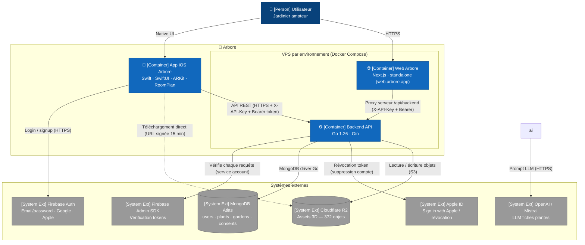

# C4 — Niveau 2 : Containers

Cette vue ouvre la boîte « Arbore » et représente les **applications et services déployables**. Un container correspond à une unité runtime indépendamment déployable : un process iOS, un container Docker ou un service Apple/cloud managé.

Pour le niveau supérieur (acteurs et systèmes externes), consulter [`01-context.md`](01-context.md).

## Diagramme

> **Note de rendu** : la sémantique C4 (Person, Container, System Ext) est préservée dans les labels. La syntaxe utilisée est `flowchart` plutôt que `C4Container` natif, car le layout du C4 Mermaid est encore expérimental et produit des chevauchements d'arêtes sur les graphes denses.

## Points clés

- **Trois containers Arbore sont en production** : l'application iOS, le front web Next.js et le backend Go. L'AI Generator Python a été déposé le 2026-09-20 (#558), faute de trafic et avec un schéma de sortie périmé. Les deux containers serveur sont orchestrés par `docker-compose.yml`.
- **Deux VPS, et non plus un seul** (relevé le 2026-11-02). La migration de #652 est en cours : `prod` est resté sur l'ancienne machine Fedora, `dev` tourne sur la nouvelle machine Debian, qui porte aussi l'atelier 3D. Voir [`../operations/environnements.md`](../operations/environnements.md) pour la répartition exacte.
- **Le front web est déployé** sur `web.arbore.app` (Cloudflare → nginx → container `arbore-web` sur le port 3000). Il sert de compagnon à l'app iOS : consultation du catalogue, des jardins, calendrier d'arrosage, gestion du compte (export/suppression RGPD). Les jardins sont **créés sur iOS** (placement AR).
- **Le web n'expose jamais la clé API ni l'URL du backend au navigateur** : tous les appels passent par un **proxy serveur same-origin** (`/api/backend`) qui injecte `X-API-Key` côté serveur et relaie le token Firebase de l'utilisateur. Conséquence : pas de CORS côté navigateur, clé API jamais exposée.
- **Deux barrières de sécurité protègent l'accès aux données** :
  1. **X-API-Key** validée par un middleware backend dédié (comparaison à temps constant) — limite l'exposition aux requêtes automatisées non autorisées venant de l'extérieur.
  2. **Bearer Firebase token** validé par le Firebase Admin SDK côté backend — garantit que la requête provient d'un utilisateur authentifié, vérifié et non banni, et fournit son `uid`.
- **MongoDB Atlas est externe au système Arbore** mais piloté exclusivement par le backend. Les clients (iOS, web) n'ouvrent **jamais** de connexion MongoDB directe.
- **Backend et Web partagent le même VPS** et communiquent via le réseau Docker interne (`http://backend:8080`) plutôt que via l'IP publique.
- **HTTPS en façade** : l'accès public se fait en HTTPS via Cloudflare (Full strict), nginx restreint aux IP Cloudflare ; le durcissement TLS Cloudflare → origine est suivi côté opérations (cf. [`../operations/vps-bootstrap.md`](../operations/vps-bootstrap.md)).

### Les containers sous profil

Trois services de `docker-compose.yml` ne démarrent **jamais** avec un
`docker compose up -d` : ils sont déclarés sous un profil, et il faut le
nommer. C'est délibéré — ce sont des outils, pas des services.

| service | profil | rôle |
|---|---|---|
| `vignettes` | `outils` | job de rendu des vignettes, invoqué à la demande |
| `vignettes-ouvrier` | `vignettes` | le même binaire en veille, consomme la file de l'atelier |
| `minio` | `dev` | stockage objet local, **jamais démarré** à ce jour |

`minio` existe pour éprouver le fournisseur S3 sans toucher à R2. Vérifié le
2026-11-02 : aucun conteneur minio n'a jamais tourné sur la machine de dev.

L'ouvrier de vignettes est plafonné en CPU — un rendu Blender prend tout ce
qu'on lui laisse, et une passe de catalogue dure des heures. Voir
[`../operations/vignettes-rendu.md`](../operations/vignettes-rendu.md).

### L'atelier n'est pas un container

`generator.arbore.app` est servi par le **même** container Next.js que
`web.arbore.app`, sur le même port 3000 ; c'est nginx qui les distingue par
`server_name`, et le middleware Next qui exige une session de clé pour tout ce
qui vient de cet hôte.

Pas de second service, à dessein : le pare-feu d'origine n'ouvre 80 et 443
qu'aux plages Cloudflare, et ces ports sont déjà couverts. Un container de plus
serait une surface de plus, un certificat de plus, et un oubli de plus le jour
d'un durcissement.

Conséquence à connaître : l'atelier existe sur **chaque** pile qui fait tourner
le web. Il s'y désactive seul là où `GENERATOR_KEY_HASH` n'est pas renseignée —
« un atelier sans clé vaudrait un atelier sans porte ».

## Choix d'infrastructure

- **Un VPS par environnement**, depuis la migration en cours (#652). Chaque machine héberge son backend, son web et le stockage des modèles et vignettes. Cette topologie simple convient à l'échelle actuelle (bêta étudiante).
  > ⚠️ Sur la machine neuve, les deux piles partagent **un seul checkout git**, là où l'ancienne en avait deux. Les chemins par défaut du compose étant relatifs au fichier compose, ils convergent — ce qui a fait partager aux deux backends leur répertoire de vignettes en écriture. Suivi dans #434.
- **Docker Compose** orchestre les containers serveur via `docker-compose.yml` à la racine du dépôt, avec **un projet par environnement** (`arbore-prod`, `arbore-dev`) : sans nom de projet, compose le déduit du répertoire, identique pour les deux piles, qui se recycleraient mutuellement. Kubernetes est volontairement écarté à ce stade pour limiter la complexité opérationnelle.
- **Firebase est un service managé** : le projet consomme l'authentification sans en assumer l'exploitation. Le compromis vendor lock-in / vitesse de delivery est tracé dans l'[ADR 0004](../decisions/0004-firebase-auth.md).

## Hors-scope de cette vue

- Le détail des **modules à l'intérieur** d'un container relève du niveau 3 (Component), traité dans [`03-components-ios.md`](03-components-ios.md), [`03-components-backend.md`](03-components-backend.md) et [`03-components-web.md`](03-components-web.md).
- Le **schéma de données MongoDB** est documenté dans [`04-data-model.md`](04-data-model.md).
- Les **parcours utilisateur** (signup, placement AR, sauvegarde de jardin) sont décrits dans [`../flows/`](../flows/).
- Le **déploiement** (VPS, Docker, TestFlight) est documenté dans [`../operations/`](../operations/).
