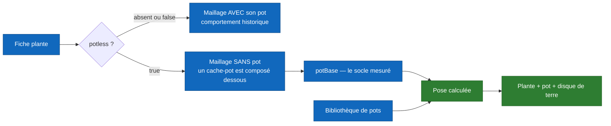

# Les pots et les cache-pots

Depuis que l'atelier 3D produit des plantes **recoupées** — un maillage sans
son pot d'origine —, une plante ne peut plus s'afficher seule : il lui faut un
cache-pot, et l'échelle de ce pot dépend de la plante.

Cette page dit qui décide de quoi. Elle existe parce que la règle vit à trois
endroits — le backend Go, l'app iOS, l'atelier — et qu'une règle écrite trois
fois diverge si personne ne dit laquelle fait foi.

Pour la fabrication des maillages, voir [`../operations/atelier-3d.md`](../operations/atelier-3d.md).
Pour les champs de la fiche, [`04-data-model.md`](04-data-model.md).

## Deux états, un seul champ



`sansPot(p)` vaut `p.Potless != nil && *p.Potless` : **sans le champ, rien ne
change**. Les plantes historiques s'affichent exactement comme avant.

## Le socle, et pourquoi il n'est pas en centimètres

`potBase` (`PotBase` dans `ArboreBackend/pots.go`) est mesuré par l'atelier **en
unités du modèle de la plante**, pas en centimètres : un maillage généré n'est
pas à l'échelle réelle.

| champ | ce qu'il porte |
|---|---|
| `x`, `y`, `z` | centre du socle — `y` est la **hauteur de la lèvre**, où s'aligne le haut du pot |
| `radius` | rayon du socle |
| `groundY` | ligne de terre (#185) |
| `plantHeight` | hauteur du végétal seul |

La taille **réelle** est un autre champ, `heightMeters`, mesuré à part sur
`/generator/tailles` — depuis la terre et non depuis le bas du pot. Sans lui,
le client retombe sur `autoScaleTargetHeightMeters = 0,5 m`, qui met toute
plante à la même taille. Les deux ne se confondent pas : l'un sert à **poser le
pot**, l'autre à **poser la plante**.

## Qui sert quoi

| | route | ce qu'elle rend |
|---|---|---|
| la bibliothèque | `GET /pots` | les pots seuls, sans pose |
| une fiche | `GET /plants/:id` | la plante **plus son pot résolu**, dans la même charge |
| une fiche, autre pot | `GET /plants/:id?pot=<id>` | la même, avec le pot demandé |
| le catalogue | `GET /plants` | chaque plante `potless` avec son pot par défaut |

**Le pot par défaut voyage avec la plante, et c'est un choix.** Un second appel
serait toujours en série derrière le premier — le client ne sait qu'après coup
si la plante a besoin d'un pot — et la plante s'afficherait nue le temps de
l'aller-retour. Le JSON reste plat : `plantResponse` embarque `Plant` et ajoute
un `pot` optionnel, donc un client qui ignore le champ ne voit aucun changement.

**Changer de pot, en revanche, ne repasse pas par le serveur.** Le socle
appartient à la plante, la bibliothèque est chargée une fois et gardée, et la
pose tient en une division. Le sélecteur est donc instantané, et un jardin se
rouvre hors ligne.

> Un pot demandé qui n'existe plus **ne lève pas d'erreur** : `choisirPot`
> retombe sur le pot par défaut. Le choix de l'utilisateur est persisté dans sa
> scène ; une erreur ici viderait un jardin déjà enregistré.

## La règle de pose

```
échelle = socle.radius / pot.rimRadius
centre  = (socle.x, socle.y, socle.z)
```

Le pot est mis à l'échelle, centré sur le socle, **sa lèvre alignée sur
`socle.y`**. C'est tout — `PlantPotComposer.placement`, dans
`ArboreUi/ArboreUi/Models/PlantPot.swift`, et `poserPot` côté Go.

### Le disque de terre

L'atelier ne conserve la terre de la plante qu'à **75 %** du rayon, alors que
le pot est posé à 100 % de `socle.radius`. Sans un disque au fond, un anneau de
paroi nue reste visible tout autour.

Quatre constantes le dimensionnent, et elles décrivent **ce pot-ci**, pas une
règle générale :

| constante | valeur | ce qu'elle mesure |
|---|---|---|
| `partOuverture` | `0,9445` | part du rebord occupée par l'**ouverture** — `rimRadius` est le rayon extérieur, et la paroi forme deux coques (0,0589 et 0,0554 mesurés) |
| `retraitTerre` | `0,06` | retrait de la face de terre sous la lèvre, en part de la hauteur |
| `margeDisque` | `0,985` | marge contre le z-fighting avec la paroi |
| `epaisseurDisque` | `0,02` | épaisseur, en part de la hauteur |

> **Ces quatre valeurs existent en double**, dans `pots.go` et dans
> `PlantPot.swift`. La duplication est assumée — le serveur compose pour le
> catalogue, l'app recompose en AR après un changement de pot — et **un test
> les épingle nommément des deux côtés** : les changer d'un seul côté fait
> tomber la CI au lieu de diverger en silence.
>
> Le jour où la bibliothèque compte un second pot, ce ne sont plus des
> constantes mais des mesures à porter sur sa fiche.

Le disque se calcule sur les dimensions du pot **déjà mis à l'échelle**, telles
que le moteur les lit sur le maillage chargé, et non sur les champs de la
fiche : en AR, le client ne dispose que d'un `PersistedPot`, qui porte la pose
mais ni `rimRadius` ni `height`. Sans dimensions utilisables, pas de disque —
un anneau nu vaut mieux qu'un disque au mauvais endroit.

## Ce qui est enregistré, et où

Le pot choisi vit dans la **scène locale**, `scene_{id}.json`, sous
`PersistedPot` (`ArboreUi/ArboreUi/Views/GardenLocalStore.swift`) : identifiant,
URL du modèle, échelle, décalage, et l'empreinte du contenu pour que le cache
suive un pot remplacé. La pose est enregistrée **déjà résolue**, comme la plante
enregistre sa propre transformation.

> ⚠️ **Le document `gardens` côté Mongo ne porte aucun pot.** `PlacedPlant` n'a
> que `plantId` et une position. Un jardin enregistré **avant** la 1.0.2 se
> rouvre donc sans ses pots : la donnée n'avait jamais été écrite, et rien ne
> peut la reconstituer. Les jardins créés depuis les gardent.

## Ce qui n'existe pas, et pourquoi

- **Aucune compatibilité pot ↔ plante.** La bibliothèque est libre : un pot va
  sous n'importe quelle plante. Rien ne justifie aujourd'hui des contraintes
  par plante — question ouverte de #623.
- **Aucun pot servi sans `potBase`.** Une plante recoupée dont le socle n'a pas
  été mesuré ne reçoit rien, par conception : poser un pot à une échelle
  devinée serait pire que de ne rien poser.

## Voir aussi

- [`../operations/atelier-3d.md`](../operations/atelier-3d.md) — la coupe, la mesure du socle, la page des tailles
- [`../operations/chaine-plante.md`](../operations/chaine-plante.md) — la chaîne de bout en bout
- [`04-data-model.md`](04-data-model.md) — `potless`, `potBase`, `versions`
- [`03-components-backend.md`](03-components-backend.md) — les routes et leurs gardes
