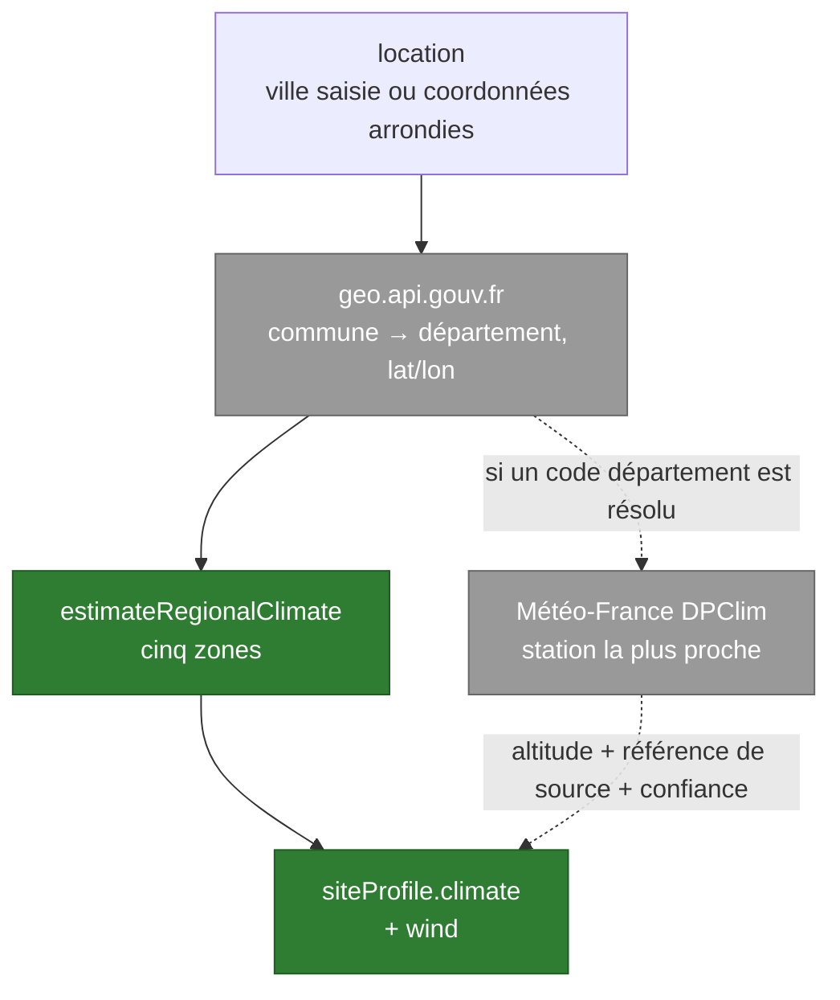

# Le profil climatique et la fiche d'espace

Après le scan, l'utilisateur donne une localisation approximative ou une ville.
Le backend en tire un **profil de site** — températures historiques, risque de
gel, vent, exposition littorale, altitude — qui alimente ensuite le classement
du catalogue.

Cette page dit ce que ce profil contient vraiment, et surtout **ce qu'il ne
mesure pas**. Elle existe parce que la route était citée en passant par quatre
documents sans qu'aucun ne décrive son contenu.

Code : `ArboreBackend/climate.go`. Flux utilisateur :
[`../flows/garden-creation.md`](../flows/garden-creation.md).

## La route

`POST /climate/profile`, dans le groupe **protégé** (clé d'API + jeton
Firebase). Corps : une `location`. Réponse : un `siteProfile` et une
`attribution`.

Sans localisation exploitable, la route répond **422** et le parcours continue
sans climat : le moteur de catalogue garde alors ses données manquantes en
« à confirmer » plutôt que de deviner.

## Cinq zones, et une par défaut

`estimateRegionalClimate` classe la commune dans l'une de cinq zones, par des
heuristiques de nom et de coordonnées :

| zone | gel | vent | confiance |
|---|---|---|---|
| `mediterranean` | `occasional` | `moderate` | `medium` |
| `mountain` | `severe` | `moderate` | `medium` |
| `oceanic` | `occasional` | selon le littoral | `medium` |
| `continental` | `regular` | `light` | `medium` |
| `temperate` *(défaut)* | `regular` | `light` | **`low`** |

L'ordre d'évaluation compte : méditerranéen, montagne, océanique, continental,
puis le repli tempéré. Une commune qui ne déclenche aucune heuristique reçoit
donc un profil explicitement peu fiable, et le dit.

## Ce que Météo-France apporte — et ce qu'il n'apporte pas

Quand un code département est résolu, le backend interroge l'API **DPClim** des
Données Publiques de Météo-France pour trouver la **station la plus proche**.

> ⚠️ **Les températures restent celles de l'estimation régionale.** La station
> ne fournit pas de relevé : elle apporte son **altitude**, change la référence
> de source affichée, et fait passer la confiance de `low` à `medium`. Le champ
> `metadata.source` vaut `regionalEstimate` dans tous les cas, station trouvée
> ou non.
>
> Ce n'est pas un défaut caché : c'est ce que le champ déclare. Mais
> l'attribution affichée — « Source : Météo-France Données Publiques » — peut
> laisser croire à une mesure, alors qu'elle désigne la station qui a servi à
> situer le lieu.

L'appel est borné à **3,5 secondes** (`climateRequestTimeout`). Un échec, un
dépassement ou une absence de station ne font rien échouer : le profil régional
part tel quel, avec sa confiance d'origine.

## Ce que porte le profil

| champ | contenu |
|---|---|
| `climate.historicalMinimumTemperature` · `...Maximum` | bornes de la zone, en °C |
| `climate.frostRisk` | `occasional`, `regular` ou `severe` |
| `climate.coastalExposure` | booléen, déduit de la commune et des coordonnées |
| `climate.altitude` | **uniquement** si une station a été trouvée et porte une altitude |
| `wind` | `light`, `moderate` ou le niveau littoral |
| `plantingZones` | toujours initialisé à vide — il se remplit côté app |

Chaque valeur porte la même `metadata` : `source`, `confidence`,
`sourceReference` et `observedAt`. C'est ce quatuor qui permet à la fiche
d'espace d'afficher « estimation régionale » plutôt qu'un chiffre nu, et de
distinguer **mesurée**, **déduite**, **déclarée** et **estimation régionale**.

## Où le profil atterrit

Le client fusionne la réponse dans `wizard.siteProfile` et persiste le tout par
`PUT /gardens/:id`. Ces écritures sont sérialisées, pour qu'un ancien
instantané ne termine pas en dernier et n'efface pas la localisation ou le
climat. Un profil **manuel** déjà posé par l'utilisateur reste prioritaire : la
réparation côté app ne réécrit jamais une correction existante.

## Configuration

| Variable | Rôle |
|---|---|
| `METEOFRANCE_API_KEY` / `_TOKEN` | accès aux Données Publiques ; absentes, la station n'est jamais cherchée |
| `METEOFRANCE_CLIMATE_BASE_URL` | défaut `https://public-api.meteofrance.fr/public/DPClim/v1` |
| `GEOGOUV_API_BASE_URL` | défaut `https://geo.api.gouv.fr` |

## Voir aussi

- [`../flows/garden-creation.md`](../flows/garden-creation.md) — où la localisation est demandée
- [`03-components-backend.md`](03-components-backend.md) — les variables et les gardes de la route
- [`04-data-model.md`](04-data-model.md) — `wizard.siteProfile` dans le document `gardens`
